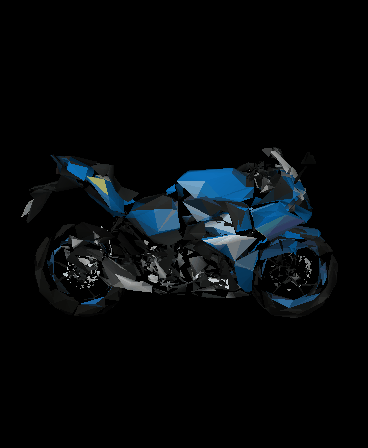
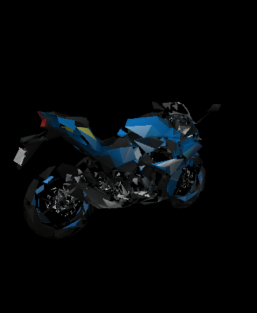
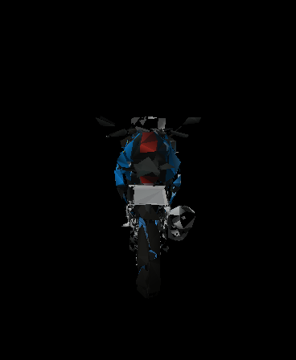

# GSX-250R 3D viewer for the ESP32-S3 AMOLED

A Suzuki GSX-250R drawn as real-time 3D on the **Waveshare ESP32-S3-Touch-AMOLED-1.8** (368×448). Everything runs on the ESP32: a small software rasterizer with a z-buffer and Gouraud lighting draws 4,000 triangles at 20+ fps. Drag it with your finger or tilt the board to look around.

<p align="center">
  
</p>

| Side | Three-quarter | Front |
|---|---|---|
|  |  |  |

*These previews come from `tools/preview.py`, which draws the mesh with the same projection, lighting and z-buffer as the firmware. They are not photos of the board.*

## Controls

- **Drag** to rotate. If you flick it, it keeps spinning and slows down.
- **Leave it alone.** After 2.5 s it eases back into a slow turn by itself.
- **Tilt the board** to swing the view. The QMI8658 accelerometer measures tilt from the position the board has been resting in, so if you hold a tilt the view slowly settles back.
- **BOOT button** turns tilt control on and off.

## How it works

1. **Model.** The model was made with Higgsfield (Tripo H3.1 image-to-3D), which produced a GLB with about 57k triangles and a 4K texture.
2. **Conversion** (`tools/convert_model.py`, run on a PC):
   - Shrinks the mesh to 4,000 triangles with `fast-simplification`.
   - Gives each new triangle one colour, taken from the texture of the original faces nearest to it.
   - Works out smooth vertex normals.
   - Stores positions as int16 and normals as int8.
   - Writes `model.h` (about 280 KB). The arrays are written as string literals, because GCC compiles those in seconds instead of minutes.
3. **Rendering** (`gsx_3d_viewer.ino`):
   - Transforms and lights every vertex once per frame.
   - Fills each triangle line by line, with depth and brightness worked out in fixed point.
   - Draws both sides of every triangle and lights whichever side faces the camera. Tripo meshes have mixed winding, so culling back faces would leave holes.
   - Clears only the area the bike covered last time and covers now.
   - Uses two PSRAM framebuffers: core 1 draws one frame while core 0 sends the previous one to the panel over QSPI.

Both board revisions are handled. At boot the sketch checks I2C address 0x38: a V1 board has the FT3168 touch chip there and uses the SH8601 display driver. A V2 board has a CST820 at 0x15 and uses the CO5300 driver.

## Build

You need the esp32 Arduino core 3.3.x and GFX Library for Arduino 1.6.7.

```bash
arduino-cli compile -b "esp32:esp32:esp32s3:PSRAM=opi,FlashSize=16M,PartitionScheme=app3M_fat9M_16MB,CDCOnBoot=cdc" --build-path build .
```

```bash
arduino-cli upload -p COM6 -b "esp32:esp32:esp32s3:PSRAM=opi,FlashSize=16M,PartitionScheme=app3M_fat9M_16MB,CDCOnBoot=cdc" --input-dir build .
```

After flashing, the board can stay in download mode. With a battery fitted, hold PWR for 6–8 s to turn it off, then press PWR again.

## Using another model

```bash
pip install trimesh fast-simplification scipy pillow
```

```bash
python tools/convert_model.py your_model.glb --faces 4000 --npz mesh.npz
```

```bash
python tools/preview.py mesh.npz images --gif
```

The converter expects a single mesh with a base-colour texture, which is what Higgsfield, Tripo and Meshy export. Using more faces looks better but drops the frame rate.
